# Awesome Appointment Scheduling 📅✨

> 🚀 A curated list of awesome appointment scheduling SaaS platforms, calendar sync tools, inbound meeting routers, and open-source booking infrastructure.

Appointment scheduling tools empower individuals, service professionals, sales teams, and enterprises to automate booking workflows, eliminate back-and-forth emails, resolve scheduling conflicts across time zones, and qualify/route inbound leads in real time. ⚡

---

## 📑 Table of Contents

- [📊 Sector Overview & Market Dynamics](#-sector-overview--market-dynamics)
- [🏢 SaaS & Hosted Platforms](#-saas--hosted-platforms)
- [💻 Open-Source GitHub Projects](#-open-source-github-projects)
- [🤝 How to Contribute](#-how-to-contribute)
- [⭐ Star History](#-star-history)
- [💖 Support](#-support)
- [⚖️ Disclaimer & Evaluation Guide](#️-disclaimer--evaluation-guide)

---

## 📊 Sector Overview & Market Dynamics

The global appointment scheduling software market is estimated at **$450M–$600M+ in 2024 and projected to reach $1.3B+ by 2030** (growing at a ~13–15% CAGR). 📈

The sector is **moderately fragmented** rather than winner-take-all:
- 🌐 **Broad self-serve personal/team scheduling** is anchored by category leaders like **Calendly**, but broad horizontal reach leaves ample room for specialized players.
- 🎯 **Verticalized niches** (such as **Acuity** for beauty/wellness/consultations, **Square Appointments** for omnichannel point-of-sale retail, and **Chili Piper** for enterprise B2B inbound routing) maintain strong moats and pricing power.
- 🔓 Simultaneously, privacy concerns, HIPAA/GDPR data residency mandates, and customizable developer workflows have fueled rapid expansion of **open-source and self-hosted scheduling infrastructure** (pioneered by **Cal.com**).

---

## 🏢 SaaS & Hosted Platforms

The table below covers prominent hosted appointment scheduling and automated booking platforms, sorted in descending order by estimated company valuation / annual revenue scale. 💼

| Platform | Company Scale (Valuation / Revenue) | Pricing (Starting Tier) | Free Tier Limits | Key Highlights & Target Use Case |
| :--- | :--- | :--- | :--- | :--- |
| **[Square Appointments](https://squareup.com/appointments)** | **~$40B+ Market Cap** (Block Inc. parent) | **$29/location/month** (Plus plan; 30-day free trial) | **Free Forever plan**: 1 staff member/calendar, basic appointment booking, POS integration, unlimited appointments. (Paid Plus unlocks multi-staff, automated text reminders, Google Calendar sync). | 💳 Best for service-based businesses, salons, and retail requiring integrated point-of-sale (POS) and payment processing. |
| **[HubSpot Meetings](https://www.hubspot.com/products/sales/schedule-meeting)** | **~$28B+ Market Cap** (HubSpot Inc. parent) | **$15/seat/month** (Sales Hub Starter billed annually) | **Free Forever plan**: 1 personal meeting link per user with HubSpot branding, basic CRM contact creation, and calendar sync (Google/Office 365). (Paid removes branding and unlocks round-robin team links). | 📇 Seamless CRM-native meeting scheduling with instant deal and contact record creation for marketing and sales teams. |
| **[Acuity Scheduling](https://acuityscheduling.com/)** | **~$6.9B Acquisition** (Squarespace parent) | **$16/month** (Emerging plan billed annually, or $20/month billed monthly) | **7-day free trial only** (Full access during trial; no free-forever plan available). Requires paid Squarespace/Acuity account. | 🧘 Built for consultants, wellness providers, coaches, and salons requiring intake forms, recurring subscriptions, and deposit collection. |
| **[Calendly](https://calendly.com/)** | **~$3.0B+ Valuation** (~$150M+ ARR) | **$10/user/month** (Standard plan billed annually, or $12/month billed monthly) | **Free Forever plan**: 1 active event type, 1 calendar connection, automated event notifications, unlimited 1-on-1 bookings. (No group events, automated SMS, or payment integrations). | 🗓️ The global standard for individual and team booking pages; ubiquitous calendar sync and effortless one-on-one booking. |
| **[Chili Piper](https://www.chilipiper.com/)** | **~$625M Valuation** (~$30M+ ARR) | **$15/user/month** (Instant Booker) or **$30/user/month** (Handoff); Form concierge starts at **$150+/platform/mo** | **No free-forever plan**; 14-day free trial available upon sales qualification for product tier evaluation. | 🌶️ Enterprise inbound conversion engine that qualifies leads from web forms and routes them to reps based on CRM territory/routing rules. |
| **[Doodle](https://doodle.com/)** | **~$100M+ Acquisition** (TX Group) | **$6.95/user/month** (Pro plan billed annually, or $14.95 billed monthly) | **Free Forever plan**: Unlimited basic group polls with ads; 1 booking page with Doodle branding. (Ad-free, 1:1 meetings, and calendar sync require Pro). | 🗳️ Optimal for group consensus polling, committee availability finding, and board meeting coordination. |
| **[OnceHub](https://www.oncehub.com/)** | **~$20M–$40M Valuation** (~$10M+ ARR) | **$10/user/month** (Schedule plan billed annually, or $12 billed monthly) | **Free Forever plan**: Up to 3 users, 1 live booking page, 25 meetings per month, video conferencing integrations. | 💬 Multi-channel customer journey scheduling with chatbots, instant live calls, and round-robin team assignment. |
| **[YouCanBookMe](https://youcanbook.me/)** | **~$15M–$30M Valuation** (~$5M–$8M ARR) | **$7.20/calendar/month** (Paid plan billed annually, or $9 billed monthly; 14-day free trial) | **Free Forever plan**: 1 linked calendar, 1 booking page type, basic email notifications, YCBM branding. (SMS reminders and custom styling require paid plan). | 🌍 Highly customizable booking pages with multi-language support (40+ languages), personalized forms, and Zapier connectivity. |
| **[Setmore](https://www.setmore.com/)** | **Bootstrapped / ~$10M–$20M ARR** | **$5/user/month** (Pro plan billed annually for 1–2 users, or $12 billed monthly) | **Free Forever plan**: Up to 4 team members, unlimited appointments, basic email reminders, Square/Teleport video integration. | ✂️ Cost-effective team scheduling for clinics, barbershops, and solo practitioners wanting staff profiles on free tier. |

---

## 💻 Open-Source GitHub Projects

Self-hosted and developer-first appointment scheduling infrastructure. Repositories are sorted in descending order by GitHub stargazers. 🌟

| Project | Stars | Tech Stack / Architecture | Key Highlights & Description |
| :--- | :--- | :--- | :--- |
| **[Cal.com](https://github.com/calcom/cal.com)** |  | Next.js, React, TypeScript, Prisma, PostgreSQL | 🌐 **The premier open-source scheduling infrastructure** (formerly Calendso). Full feature parity with Calendly: round-robin routing, collective events, team availability, webhooks, app store (Zoom, Meet, Stripe), and complete data ownership. |
| **[Easy!Appointments](https://github.com/alextselegidis/easyappointments)** |  | PHP (CodeIgniter), JavaScript, MySQL | 🛠️ **Highly reliable self-hosted booking engine** for businesses and service providers. Provides responsive customer booking, multi-provider calendar management, and Google Calendar sync. |
| **[Someday](https://github.com/rbbydotdev/someday)** |  | React, TypeScript, Tailwind, Google Apps Script | ⚡ **Free-to-host calendar availability picker**. An ultra-lightweight open-source Cal.com / Calendly alternative built on Google Apps Script for Gmail/Google Workspace users without separate server hosting costs. |
| **[CloudMeet](https://github.com/dennisklappe/CloudMeet)** |  | TypeScript, Cloudflare Workers / Pages, D1 | ☁️ **Edge-native Calendly alternative running on Cloudflare's free tier**. Minimalist meeting scheduler with Google Calendar and Microsoft Outlook bidirectional synchronization. |
| **[Open Reception](https://github.com/open-reception/appointment-booking-software)** |  | Node.js, React, MongoDB | 🔒 **End-to-end encrypted appointment booking platform**. Designed for privacy-first operations, medical clinics, and confidential client consultations requiring cryptographic protections. |
| **[django-appointment](https://github.com/adamspd/django-appointment)** |  | Python, Django | 🐍 **Modular appointment scheduling Django app**. Easily pluggable into existing Django web applications with support for custom working hours, buffer times, staff assignment, and email alerts. |
| **[Punctual](https://github.com/CCCrafts/punctual)** |  | TypeScript, Cloudflare Workers | ⏱️ **Edge-native scheduling engine without seat limits**. Fast, serverless, and lightweight open scheduler with zero-cold-start performance and MIT licensing. |
| **[DaySchedule Widget](https://github.com/dayschedule/dayschedule-widget)** |  | JavaScript / Web Components | 🧩 **Embeddable appointment booking calendar widget** for websites. Supports 1:1, round-robin, and group bookings with Google Meet, Zoom, and MS Teams integrations. |
| **[Kalle](https://github.com/kalle-app/kalle)** |  | Blitz.js, React, Prisma | 🎈 **Clean, minimal appointment scheduling tool**. Allows scheduling meetings with colleagues, customers, or friends in seconds with intuitive date-slot selections. |
| **[NexCal](https://github.com/ribato22/nexcal)** |  | Next.js 16, PostgreSQL, Docker | 🐳 **Modern self-hosted Calendly alternative**. Containerized booking system built with modern React Server Components, Docker deployment, and local database control. |
| **[NextAppointments](https://github.com/ajdichmann/NextAppointments)** |  | Next.js, React, TypeScript, Node.js | 📦 **Full-stack self-hosted appointment scheduler**. Features customizable availability, SMS/email alerts, responsive design, and CRM/payment integrations. |

---

## 🤝 How to Contribute

We welcome community contributions to keep this list accurate and comprehensive! 🙌

1. 🍴 Fork this repository.
2. 📝 Add your SaaS product or open-source tool following the existing tabular structure.
   - For SaaS: Must include specific company scale, starting tier pricing, and exact free tier limits.
   - For Open-Source: Must include a shields.io social star badge linking to `/stargazers`, tech stack, and descriptive overview.
3. 🎯 Keep descriptions objective, concise, and factual.
4. 🚀 Submit a Pull Request with a clear title and description.

---

##  Star History

---

## 💖 Support

Thank you for visiting and using this resource! 🙏 If you find this curated ecosystem helpful, please consider showing your support:

- ⭐ **Star this repository** to help others discover it on GitHub.
- 🍴 **Fork and contribute** by adding new tools or updating pricing information.
- 📢 **Share it** with fellow engineers, founders, and operations teams.
- ☕ **Buy a coffee / Sponsor**: Support ongoing maintenance through the [GitHub Sponsor Dashboard](https://github.com/sponsors/ishandutta2007).

---

## ⚖️ Disclaimer & Evaluation Guide

- 🔍 **Community Curated**: This list is independently maintained for developers, entrepreneurs, and IT operations teams.
- 🛡️ **Data Compliance**: Scheduling tools store client email addresses, meeting notes, phone numbers, and calendar tokens. Ensure your deployment conforms to regulations such as GDPR, CCPA, and HIPAA (where applicable).
- 💻 **Self-Hosting Considerations**: Open-source platforms like **Cal.com** and **Easy!Appointments** grant 100% data ownership and eliminate per-seat licensing fees, but require operational maintenance, secure database backups, and webhook endpoint monitoring.
